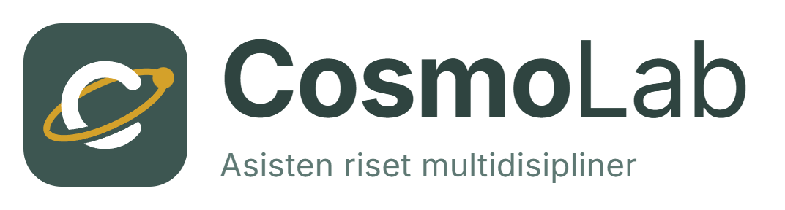
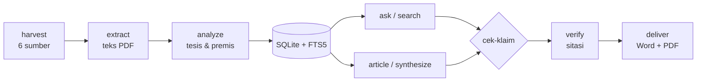

<div align="center">

<picture>
  <source media="(prefers-color-scheme: dark)" srcset="cosmolab/assets/logo-dark.png">
  
</picture>

### Asisten riset multidisipliner: dari mencari paper sampai dokumen siap kirim ke klien

Panen paper open-access, baca dan analisis dengan AI, tanya seluruh koleksi,
lalu tulis artikel yang setiap kutipannya sudah diperiksa.


[Fitur](#fitur) ·
[Mulai cepat](#mulai-cepat) ·
[Alur kerja](#alur-kerja) ·
[Perintah CLI](#perintah-cli) ·
[Arsitektur](#arsitektur) ·
[Panduan tim](PANDUAN_TIM.md)

</div>

---

## Kenapa CosmoLab?

Riset literatur biasanya tersebar di banyak tab browser, folder PDF, dan catatan.
Jawaban AI terdengar meyakinkan, tetapi rujukannya sering salah atau tidak ada.
CosmoLab menyatukan semua langkah dalam satu tempat dan **memeriksa setiap klaim
terhadap teks paper aslinya** sebelum hasilnya sampai ke klien.

- **Satu alat, satu alur.** Cari, unduh, ekstrak, analisis, tanya, tulis, kirim.
- **Bisa dilacak.** Setiap kalimat bersitasi dicek terhadap halaman paper yang dirujuk.
- **Lintas bidang.** Filsafat, agama, hukum, ekonomi, pendidikan, psikologi, sosial, sains, teknologi, kesehatan.
- **Bahasa Indonesia jadi warga kelas satu.** Tanya dalam bahasa Indonesia, cari di korpus berbahasa Inggris.
- **Siap untuk firma riset.** Proyek per klien, akses tim lewat Tailscale, catatan biaya AI, dokumen Word/PDF berkop firma.

## Fitur

<table>
<tr>
<td width="50%" valign="top">

### 1 · Kumpulkan paper
- **Panen federasi** dari 6 sumber sekaligus: arXiv, OpenAlex, DOAJ, Semantic Scholar, CORE (butuh `CORE_API_KEY`), Crossref, dengan deduplikasi judul.
- **Bedah DOI seketika**: masukkan DOI, dapat ringkasan Abstrak, Metode, Hasil, Kesimpulan, dan celah riset.
- **Snowballing sitasi**: telusuri rujukan (backward) dan paper yang mengutip (forward).
- **Lengkapi metadata**: penulis, DOI, dan cek data bibliografi lewat Crossref/DataCite, termasuk status retraksi.

</td>
<td width="50%" valign="top">

### 2 · Baca & analisis
- **Ekstraksi teks sadar tata letak**, aman untuk paper dua kolom.
- **Analisis argumen terstruktur** (tesis, premis, temuan, kutipan) dengan output Pydantic.
- **Cek analisis**: hasil AI dibandingkan lagi dengan teks PDF.
- **Diagram argumen** dalam Mermaid.
- **Koreksi peneliti** tersimpan dan diutamakan di atas hasil AI.

</td>
</tr>
<tr>
<td width="50%" valign="top">

### 3 · Tanya & tulis
- **Tanya korpus (Agentic RAG)** dengan sitasi sampai nomor halaman.
- **Gatekeeper klaim**: setiap kalimat bersitasi dinilai *didukung*, *sebagian*, atau *tidak didukung*.
- **Review draf mahasiswa** (S1–S3): komentar ala pembimbing per paragraf, plus cek sitasi. Setiap komentar AI wajib mengutip kalimat draf (dicek otomatis) dan harus diterima, diedit, atau dibuang konsultan sebelum dikirim.
- **Studio artikel**: esai, tinjauan jurnal, atau monograf.
- **Laporan sintesis**, matriks literatur, dan pencari celah riset.

</td>
<td width="50%" valign="top">

### 4 · Kirim ke klien
- **Periksa sitasi** terhadap koleksi proyek dan Crossref: tahun salah, penulis salah, rujukan fiktif.
- **Word + PDF berkop firma**, hanya dibuat setelah rujukan lolos pemeriksaan.
- **Ekspor** ke BibTeX, RIS, dan Obsidian Vault dengan `[[wikilinks]]`.
- **Log audit** append-only untuk reprodusibilitas.

</td>
</tr>
</table>

**Bonus belajar:** roadmap kurikulum per fakultas, generator silabus AI, dan
**Arena Sparring** untuk menguji argumen Anda melawan persona seperti Hume,
Al-Ghazali, Ibn Sina, Mackie, Dennett, atau *The Ruthless Critic*.

## Mulai cepat

### Windows (tanpa terminal)

1. Pasang [Python 3.10+](https://www.python.org/downloads/) dan centang **Add python.exe to PATH**.
2. Klik dua kali **`Pasang CosmoLab.bat`**. Skrip membuat `.venv`, memasang paket, dan membuka `.env` di Notepad.
3. Isi `LLM_API_KEY`, `LLM_MODEL`, dan `COSMOLAB_EMAIL`, lalu simpan.
4. Klik dua kali **`Jalankan CosmoLab.bat`**, pilih proyek, dan dashboard terbuka di browser.

Anggota tim non-teknis: ikuti [PANDUAN_TIM.md](PANDUAN_TIM.md) langkah demi langkah.

### Manual (semua OS)

```bash
git clone https://github.com/adrhmnhkm/cosmolab.git
cd cosmolab
python -m venv .venv
```

```bash
.venv/Scripts/python -m pip install -e .   # Linux/macOS: .venv/bin/python
```

```bash
cp .env.example .env   # lalu isi LLM_API_KEY, LLM_MODEL, COSMOLAB_EMAIL
```

```bash
cosmolab ui
```

### Konfigurasi `.env`

| Kunci | Wajib | Fungsi |
| --- | :---: | --- |
| `LLM_BASE_URL` | ✓ | Endpoint API kompatibel OpenAI |
| `LLM_API_KEY` | ✓ | Kunci API model |
| `LLM_MODEL` | ✓ | Nama model default |
| `COSMOLAB_EMAIL` | ✓ | Identitas sopan untuk OpenAlex, Unpaywall, Crossref |
| `CORE_API_KEY` | | Cari salinan paper di repositori kampus |
| `COSMOLAB_FIRM_*` | | Nama, tagline, alamat, kontak, logo untuk kop dokumen |
| `COSMOLAB_PRICING` | | Tarif per 1 juta token, format `model:input:output;...` |
| `COSMOLAB_TEAM_PASSWORD` | | Password dashboard mode tim, minimal 10 karakter |

> [!WARNING]
> `.env` berisi kunci rahasia. Jangan commit dan jangan kirim ke klien.

## Alur kerja



Contoh satu putaran penuh untuk klien baru:

```bash
cosmolab project new 2026-11-klien-a --client "Klien A"
cosmolab -P 2026-11-klien-a harvest "islamic microfinance" --max-results 30
cosmolab -P 2026-11-klien-a extract
cosmolab -P 2026-11-klien-a analyze
cosmolab -P 2026-11-klien-a ask "Apa faktor utama keberhasilan pembiayaan mikro syariah?"
cosmolab -P 2026-11-klien-a article "Pembiayaan mikro syariah di Indonesia" --style journal_review
cosmolab -P 2026-11-klien-a verify articles/20261105_Judul.md
cosmolab -P 2026-11-klien-a deliver articles/20261105_Judul.md --reviewer "Dr. Nama"
```

## Perintah CLI

Semua perintah menerima `-P <proyek>` (atau env `COSMOLAB_PROJECT`). Tanpa itu,
CosmoLab memakai folder `data/`. Lihat detail tiap perintah dengan `cosmolab <perintah> --help`.

<details open>
<summary><b>Proyek</b></summary>

| Perintah | Fungsi |
| --- | --- |
| `project new <nama> --client "..."` | Buat proyek klien di `projects/<nama>/` |
| `project list` | Daftar proyek |
| `project info` | Info proyek aktif |

</details>

<details>
<summary><b>Kumpulkan & olah paper</b></summary>

| Perintah | Fungsi |
| --- | --- |
| `harvest "<kueri>" --max-results 40` | Panen paper dari semua sumber |
| `extract [--force]` | Ekstrak teks PDF |
| `analyze` | Analisis argumen dengan LLM |
| `inspect <DOI>` / `doi <DOI>` | Bedah paper dari DOI |
| `snowball --arah both --top 20 --unduh 5` | Telusuri rujukan dan pengutip |
| `authors` | Lengkapi nama penulis |
| `dois` | Lengkapi DOI lewat arXiv dan Crossref |
| `cek-metadata` | Cek metadata dan retraksi |
| `sync` | Sinkron ulang database dan indeks pencarian |
| `status` | Status pipeline dan database |

</details>

<details>
<summary><b>Cari, tanya & tulis</b></summary>

| Perintah | Fungsi |
| --- | --- |
| `search "<kueri>" [--exact]` | Pencarian hibrida (RRF) atau FTS5 berbobot |
| `ask "<pertanyaan>" [--classic] [--no-cek]` | Tanya korpus, klaim dicek otomatis |
| `synthesize --lang id` | Laporan sintesis lintas paper |
| `article "<topik>" --style essay` | Tulis artikel (`essay`, `journal_review`, `monograph`) |
| `graph "<paper>"` | Diagram argumen Mermaid |

</details>

<details>
<summary><b>Akurasi & kualitas</b></summary>

| Perintah | Fungsi |
| --- | --- |
| `review <draf.docx> --jenjang s2` | Review draf mahasiswa: komentar pembimbing + cek sitasi (putuskan komentar di dashboard) |
| `cek-klaim <file.md>` | Cek setiap kalimat bersitasi pada draf |
| `cek-analisis [<paper>] [--semua]` | Bandingkan analisis AI dengan teks PDF |
| `uji buat` / `uji jalan` / `uji riwayat` | Set evaluasi akurasi retrieval dan pemeriksa klaim |
| `log [--csv out.csv]` | Lihat log audit |

</details>

<details>
<summary><b>Ekspor, klien & tim</b></summary>

| Perintah | Fungsi |
| --- | --- |
| `export --format obsidian` / `bibtex` | Ekspor ke Obsidian atau BibTeX |
| `pustaka --format ris` | Daftar pustaka dari metadata terverifikasi |
| `verify <file.md>` | Periksa sitasi terhadap korpus dan Crossref |
| `deliver <file.md> --reviewer "..."` | Buat Word + PDF berkop firma |
| `backup [--tanpa-pdf]` | Cadangkan data proyek ke `backups/<proyek>_<waktu>.zip` |
| `ui [--team] [--port 8501]` | Buka dashboard Streamlit |
| `usage --by feature` / `usage --all --month 2026-11` | Pemakaian token dan biaya |

</details>

## Arsitektur

### Retrieval dua tahap

Pertanyaan berbahasa Indonesia sering tidak cocok kata per kata dengan korpus
berbahasa Inggris. CosmoLab menjembataninya dengan dua jalur pencarian yang
dilebur, lalu disaring ulang oleh LLM.

```text
                    Pertanyaan peneliti
                           │
          ┌────────────────┴────────────────┐
          ▼                                 ▼
   FTS5 BM25 berbobot              Ekspansi konsep akademik
   (judul 10, tesis 10,            (istilah ID → EN, peta
    premis 8, abstrak 5,            konsep per bidang)
    teks penuh 1)                          │
          └────────────────┬────────────────┘
                           ▼
              Reciprocal Rank Fusion (top 10)
                           ▼
              Re-ranker LLM (top 3–5 paper)
                           ▼
       Pencarian passage BM25 (+ embedding opsional)
                           ▼
           Jawaban bersitasi [Judul (Tahun), Hal. N]
                           ▼
          Gatekeeper klaim: didukung / sebagian / tidak
```

Detail desain: [LAPORAN_FITUR_TERBARU.md](LAPORAN_FITUR_TERBARU.md).

### Peta modul

| Lapisan | Modul |
| --- | --- |
| Pengumpulan | `harvest`, `snowball`, `inspector`, `authors`, `dois`, `metadata` |
| Pengolahan | `extract`, `analyze`, `analysis_check`, `corrections`, `storage`, `db` |
| Pencarian | `retrieval`, `passages`, `llmcache` |
| Penalaran | `ask`, `ask_agent`, `entail`, `synthesize`, `gap_finder`, `matrix` |
| Penulisan | `writer`, `citations`, `export`, `review` |
| Klien & tim | `verify`, `deliverables`, `usage`, `audit`, `config` |
| Belajar | `faculties`, `curriculum`, `sparring` |
| Antarmuka | `cli` (Typer + Rich), `web` (Streamlit entry), `ui/` (sidebar, komponen, `ui/pages/` satu modul per halaman) |

### Struktur data proyek

```text
projects/<nama-proyek>/      # git-ignored, cadangkan rutin
├── pdf/                     # PDF hasil panen
├── text/                    # teks hasil ekstraksi
├── analysis/                # analisis argumen per paper
├── cosmolab.db              # SQLite + indeks FTS5
├── metadata.jsonl           # metadata paper
├── articles/                # artikel hasil Studio
├── synthesis/  matrices/  gaps/
├── obsidian/                # ekspor Obsidian Vault
├── deliverables/            # Word + PDF untuk klien
├── qa/                      # laporan cek sitasi (internal)
└── usage.jsonl              # catatan token per panggilan AI
```

## Mode tim

```bash
cosmolab -P 2026-11-klien-a ui --team --port 8501
```

`--team` membuka dashboard di IP Tailscale mesin ini dan memasang layar password.
Tanpa `--team`, dashboard hanya mendengar di `localhost`. Satu proyek, satu port.
Panduan lengkap untuk admin dan anggota: [PANDUAN_TIM.md §6](PANDUAN_TIM.md#6-bekerja-bersama-lewat-jaringan-tailscale).

## Pengembangan

```bash
.venv/Scripts/python -m pip install -e ".[dev]"
```

```bash
.venv/Scripts/python -m pytest tests
```

Tes mencakup pipeline, retrieval, passage grounding, gatekeeper klaim, snowballing,
DOI, penulis, deliverable, proyek, dan pencatatan biaya.

- Tes yang butuh koleksi paper lokal dilewati kalau `data/` kosong, misalnya di CI.
- Tes yang memanggil layanan luar hanya jalan dengan `COSMOLAB_NETWORK_TESTS=1`.
- GitHub Actions ([`.github/workflows/tests.yml`](.github/workflows/tests.yml)) menjalankan tes di Python 3.10 dan 3.12 setiap push dan PR.

---

<div align="center">
<sub>Dibuat untuk peneliti yang ingin cepat tanpa mengorbankan ketelitian.</sub>
</div>
